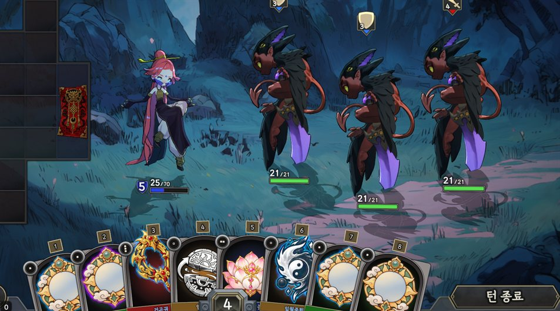
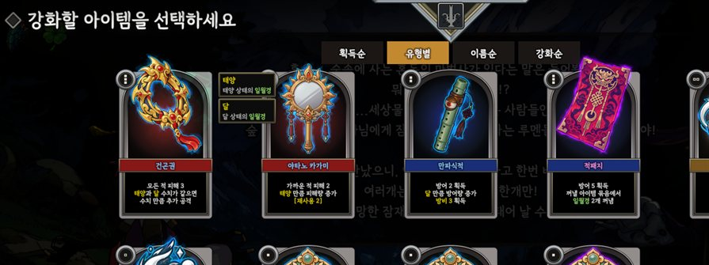

# PocketLegend Mod Control By Clann

[Pocket Legend](https://store.steampowered.com/app/3129790/) (Steam)용 **비공식 편의 모드 모음**입니다.
BepInEx 5 + HarmonyX로 게임 파일을 바꾸지 않고 실행 중에 기능을 덧붙이며, 타이틀 화면의 **모드 관리** 메뉴에서 모드마다 켜고 끌 수 있습니다.

> Unofficial quality-of-life mods for *Pocket Legend* (Steam), built with BepInEx 5 and HarmonyX.
> Korean / English UI, toggled in-game from the title screen.


## 모드 목록

| 분류 | 모드 | 목표 | 기능 | 사용법 |
|---|---|---|---|---|
| UX | **Item Sort**<br>아이템 정렬 | 많은 아이템을 원하는 순서로 보기 | 아이템 메뉴, 아이템 선택 창, 전투 더미 목록 위에 정렬 버튼 | 목록 위 **획득순 / 유형별 / 이름순 / 강화순** 클릭 |
| UX | **Always Show Item Info**<br>우클릭 상세보기 | 어떤 상황에서도 아이템 상세보기 | 원래 안 되던 선택 창, 이벤트 선택지의 아이템 이름에서도 상세보기 | 아이템(또는 아이템 이름 툴팁)에서 **우클릭**. 전투 인벤토리 우클릭은 원래대로 '사용' |
| UX | **Peek Hand Info**<br>손패 엿보기 | 아이템을 고르면서 손패도 확인 | '꺼낼 아이템을 선택하세요' 창을 접었을 때 손패 정보 표시 | 창을 **접어두기** 한 뒤 손패에 마우스 올리기 (보기 전용) |
| UX | **Inventory Fit**<br>인벤토리 맞춤 | 커진 인벤토리에 가려진 유물·캐릭터 보기 | 전투 인벤토리를 반투명하게, 클릭은 통과 | 전투 중 **Alt**. 누르고 있는 동안 / 누를 때마다 전환은 '나의 인벤토리' 화면 버튼으로 선택 |
| UI | **Item Type Count**<br>유형별 개수 | 덱 구성을 한눈에 파악 | '아이템' 아이콘 아래 무기/방어구/스킬/귀속 2x2 표 + 총 개수 동그라미 | 자동 표시 |
| UI | **Show Card Shortcut**<br>단축키 표시 | 키보드 단축키를 눈으로 확인 | 손패 위 숫자 1~0, 턴 종료 버튼 위 손패 수 / 10 | 전투 중 자동 표시, 숫자 키로 해당 손패 선택 |
| UI | **Total InvenInfo**<br>인벤토리 합계 | 현재 배치의 화력·방어 파악 | 사용 가능한 아이템 기준 총/최대 피해·방어, 고고 마력, 스택 일월경·빈칸 | 전투 중 자동 표시. 위치(인벤토리 아래 / 머리 위)와 표시 줄은 모드 관리에서 |
| BAL | **Fixed Enhance Cost**<br>강화 비용 고정 | 강화 부담 줄이기 | 대장간 강화 비용을 등급과 관계없이 강화석 1개로 | 대장간에서 평소처럼 강화 |
| BAL | **Better Card Skip**<br>보상 넘기기 | 보상을 넘겨도 손해 보지 않기 | '카드 획득', '인벤토리 조각' 보상 줄에 '보상 넘기기 (+2)' 버튼 | 전투 승리 보상 화면에서 버튼 클릭 → 골드 2 |
| BAL | **Better Start Choices**<br>시작 선택지 강화 | 더 좋은 시작 | 무작위 일반 유물 선택지 추가, 아이템 보상·인벤토리 조각을 희귀 등급으로 | 새 게임 시작 이벤트의 4번째 선택지 |
| 공통 | **Mod Switch**<br>모드 관리 | 게임 안에서 모드 켜고 끄기 | 타이틀 메뉴에서 모드별 ON/OFF와 세부 옵션, 한국어/영어 | 타이틀 '게임종료' 위 **모드 관리** → 줄 클릭 |

- **UX** 조작 편의 / **UI** 정보 표시 / **BAL** 밸런스 변경
- BAL 모드는 **싱글 전용**입니다. 협동 플레이에서는 골드와 강화석을 일행이 함께 쓰기 때문에, 협동 중에는 자동으로 적용되지 않습니다.

<br>


## 설치 (사용자)

**[최신 버전 받기 (Releases)](https://github.com/Cl4nn5/Csharp-PocketLegend-Mods/releases/latest)**: 아래 zip 중 하나를 받으세요. 처음이라면 AllInOne 하나면 됩니다. 스팀 커뮤니티 가이드에도 같은 내용이 있습니다.

| 파일 | 내용 |
|---|---|
| `PocketLegend-AllInOne` | 전부 한 번에 (BepInEx + 모든 모드) |
| `PocketLegend-1-Base` | BepInEx(모드 로더) + 모드 관리. 아래 묶음을 쓰려면 먼저 설치 |
| `PocketLegend-2-UX` / `UI` / `Balance` | 분류별 모드 묶음 (Base 필요) |

게임 폴더(`PocketLegend.exe`가 있는 곳)에 압축을 풀면 됩니다. 설치 전에는 세이브 폴더 `%USERPROFILE%\AppData\LocalLow\ShadingBox\PocketLegend\Save` 를 백업해 두세요.

## 어떻게 만들었나

### 1. 고칠 위치 찾기
- 게임이 **Mono 빌드**(IL2CPP 아님)인 것을 확인한 뒤 `Assembly-CSharp.dll`을 ILSpy(`ilspycmd`)로 디컴파일해서 기능별 진입점을 찾았습니다.
- 예) 강화 비용 = `EnhanceUI.SetCost`, 시작 선택지 = `Event_Start.Apply`, 전투 보상 = `Reward.GetBattleRewards`
- 디컴파일한 게임 코드는 저장소에 포함하지 않습니다.

### 2. Harmony 패치 4종을 상황에 맞게
| 패치 | 쓰임 | 예 |
|---|---|---|
| **Postfix** | 원래 동작 뒤에 UI 덧붙이기 | 보상 줄 UI(`RewardElementUI.Apply`) 뒤에 '보상 넘기기' 버튼 연결 |
| **Prefix + Finalizer** | "이 함수 실행 중"이라는 표시를 켜고, 예외가 나도 반드시 끄기 | 전투 보상 생성 중에 만든 보상만 넘기기 대상으로 표시, 시작 이벤트 중에 뽑은 아이템만 희귀로 |
| **Prefix (`ref` 인자)** | 넘어오는 값 바꾸기 | 시작 선택지의 인벤토리 조각 등급을 희귀로 |
| **Transpiler** | 함수 안의 계산식 하나만 IL 수준에서 교체 | 강화 비용 `ItemGrade + 1`의 `add` 명령을 `Plugin.Cost()` 호출로 |

### 3. 게임 업데이트에 버티기
- 게임 업데이트로 타이틀 메뉴에 '도감'이 추가되고 '협동 플레이' 버튼이 나중에 동적으로 붙게 바뀌었습니다. 모드 관리는 버튼 이름을 고정하지 않고, **보이는 메뉴 버튼을 매 프레임 읽어 다시 쌓는** 방식으로 대응합니다.
- 버전마다 없을 수 있는 클래스·필드(`CoopSession` 등)는 리플렉션(`AccessTools`)으로 찾고, 없으면 기본값으로 동작합니다.

### 4. 플러그인끼리 의존성 없이 연결
- 모드 관리는 다른 모드를 참조하지 않습니다. 대신 각 모드의 `Plugin` 클래스에 있는 상수와 함수를 **리플렉션으로 읽습니다**.
  ```csharp
  public const string ModCategory = "UI";             // UX / UI / BAL
  public const string NameKo = "인벤토리 합계";          // 한국어 이름
  public const bool SingleOnly = false;               // true 면 협동 플레이 중 자동 비적용 + [싱글 전용] 표시
  public const string MenuOptions = "Display/Position;Display/ShowMaxRow";  // 모드 관리에 보일 세부 옵션
  public static string MenuText(string key, string value, bool korean) { ... } // 옵션 표시 문구
  ```
- 그래서 새 모드는 이 규칙만 지키면 모드 관리 목록과 배포 README에 자동으로 들어갑니다.

### 5. 게임과 어울리는 UI
- 메뉴 버튼은 게임 버튼을 복제해서 폰트, 외곽선, 호버, 키보드 선택을 그대로 씁니다. 복제본과 원본이 같은 재질을 공유해 호버 효과가 번지는 문제는 재질을 분리해서 해결했습니다.
- 표의 단어 정렬은 TextMeshPro `<pos>` 태그로, 배지의 원 그림은 텍스처를 코드로 직접 그려서 만들었습니다.

### 6. 검증과 배포 자동화
- 개발용 빌드(`-p:ModDev=true`)에는 타이틀 화면을 자동으로 조작하며 게임 내부에서 스크린샷을 남기는 자체 테스트가 들어갑니다. 다른 창에 가려져도 결과가 남습니다.
- `tools/Package.ps1`은 전체를 새로 빌드하고, 공식 BepInEx를 내려받아 캐시하고, 분류별 zip과 README를 만듭니다. 분류와 이름은 각 모드 코드에서 읽어 옵니다.

## 빌드 (개발자)

요구 사항: .NET SDK, Steam판 Pocket Legend, 게임 폴더에 설치된 BepInEx 5.4.23.6 (x64)

이 저장소는 **게임 폴더 안에** `ModSource` 폴더로 두는 것을 전제로 합니다. 각 `.csproj`가 `..\..`(게임 폴더)의 `BepInEx\core`와 `PocketLegend_Data\Managed` DLL을 참조합니다. 게임 DLL은 저장소에 포함하지 않습니다.

```powershell
cd "<게임 폴더>\ModSource"
dotnet build ItemSort\ItemSort.csproj -c Release                       # 빌드 후 BepInEx\plugins 로 자동 복사
dotnet build ModSwitch\ModSwitch.csproj -c Release -p:ModDev=true     # 개발용 (타이틀 자체 테스트 포함)
.\tools\Package.ps1                                                    # 배포용 zip → dist\
.\tools\Preview-SteamGuide.ps1 -Open                                   # 스팀 가이드 초안(BBCode) 미리보기
```

```
ModSource/
├─ <모드 이름>/Plugin.cs, <모드 이름>.csproj   모드 10개 + ModSwitch(모드 관리)
├─ tools/Package.ps1                          배포 zip 생성
├─ tools/Preview-SteamGuide.ps1               스팀 가이드 미리보기
└─ docs/                                      스팀 가이드 초안, 이미지
```

## 개발 방식

기능 기획, 게임 안 테스트, 배포 결정은 직접 했고, 코드 작성은 [Claude Code](https://claude.com/claude-code)(AI)와 페어 프로그래밍으로 진행했습니다.

## 알림

- 개발사와 무관한 **비공식 팬 모드**입니다. 모드 관련 문의는 개발사가 아닌 제작자에게 해 주세요.
- 게임 파일과 디컴파일한 게임 코드는 포함되어 있지 않습니다.
- 버그 제보 / 피드백: 스팀 커뮤니티 가이드 댓글 또는 디스코드 `_clann`

## 라이선스

이 저장소의 소스 코드는 [MIT License](LICENSE)입니다.
배포 zip에 함께 들어가는 BepInEx(MIT), UnityDoorstop(LGPL-2.1), HarmonyX(MIT)는 각자의 라이선스를 따릅니다.
